# Olá, bem-vindo ao meu perfil! 👋

Sou Marcos Eduardo, formado em **Ciência da Computação pela Universidade Federal do Rio de Janeiro (UFRJ)** e atualmente trabalho com **Engenharia de Dados**.

Programar também é um hobby. Por aqui, você vai encontrar um pouco de tudo: projetos pessoais, estudos, automações e experimentos com diferentes tecnologias. Este é meu espaço para aprender, testar ideias e compartilhar o que vou construindo.

[LinkedIn](https://www.linkedin.com/in/marcos-eduardo96/) · [E-mail](mailto:marcos.eduardo22@gmail.com)

## Tecnologias que conheço

Na Engenharia de Dados e nos meus projetos:

### Linguagens e ferramentas de dados

### Bancos de dados

### Lakehouse, formatos e governança

### Cloud e orquestração

### Infraestrutura e desenvolvimento

## Projetos

Meus repositórios refletem interesses e aprendizados de diferentes momentos — de dados e automação a desenvolvimento de aplicações. Fique à vontade para [explorar os projetos](https://github.com/MarcosEduard0?tab=repositories)!

## Estatísticas

  

## Contribuições

<picture>
  <source media="(prefers-color-scheme: dark)" srcset="https://raw.githubusercontent.com/MarcosEduard0/MarcosEduard0/output/github-contribution-grid-snake-dark.svg" />
  <source media="(prefers-color-scheme: light)" srcset="https://raw.githubusercontent.com/MarcosEduard0/MarcosEduard0/output/github-contribution-grid-snake.svg" />
  
</picture>
